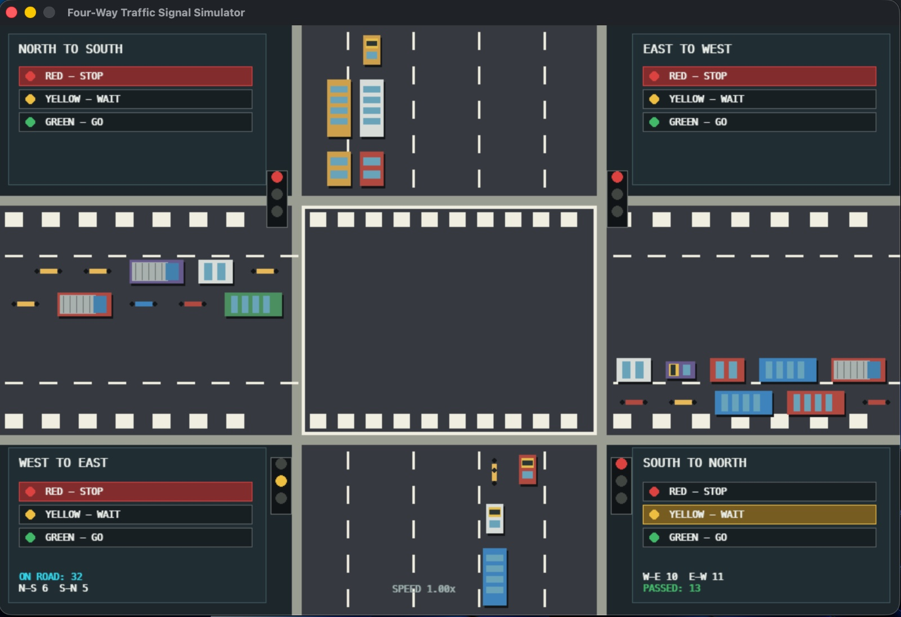

# CrossFlow 🚦
### An Interactive Four-Way Traffic Signal Simulation System

CrossFlow is an interactive traffic signal simulation system developed using **C and OpenGL**. It provides a graphical representation of a four-way road intersection where vehicles approach from different directions and respond to manually controlled traffic signals.

The project demonstrates the application of computer graphics, 2D rendering, animation, and event-driven programming to simulate and visualize traffic movement.

## ✨ Features

- **Four-Way Intersection:** Graphical representation of a four-way road intersection with lane markings and pedestrian crossings.
- **Vehicle Generation:** Generation of multiple vehicle types, including cars, buses, trucks, auto-rickshaws, motorcycles, and scooters.
- **Vehicle Animation:** Animated movement of vehicles approaching from different directions.
- **Interactive Traffic Signals:** Manual control of red, yellow, and green traffic signals.
- **Vehicle Spacing:** Basic same-lane spacing logic to reduce vehicle overlapping.
- **Live Traffic Statistics:** Displays active vehicles, directional vehicle counts, and total vehicles passed.
- **Simulation Controls:** Pause, resume, reset, and adjust simulation speed.

## 🛠️ Technologies Used

- **C** – Core programming language.
- **OpenGL** – Graphics rendering and visualization.
- **GLUT** – Window management and input handling.
- **GLU** – Graphics utility functions.

## 📸 Application Preview



## ⚙️ Getting Started

### Prerequisites

- C Compiler (GCC)
- OpenGL
- GLUT (FreeGLUT)

### Compilation and Execution

The exact compilation command depends on your compiler and installed graphics libraries.

For GCC with FreeGLUT, a typical command is:

```bash
gcc main.c -o CrossFlow -lfreeglut -lopengl32 -lglu32
```

Run the executable:

```bash
CrossFlow.exe
```

*Note: Adjust the source filename and linking options according to your project setup.*

## 🎮 Controls

| Input | Action |
|---|---|
| Mouse Click | Change traffic signal |
| Space | Pause / Resume |
| R | Reset simulation |
| Up Arrow | Increase simulation speed |
| Down Arrow | Decrease simulation speed |
| Esc | Exit simulator |

## 🧠 Concepts Demonstrated

- Computer Graphics and Visualization
- 2D Graphics Rendering
- OpenGL Drawing Functions
- Vehicle Animation
- Event Handling
- Object Movement and Position Updates
- Traffic Signal Control Logic
- Real-Time Visualization

## 🚀 Future Enhancements

- Automatic traffic signal cycles.
- Adaptive signal timing based on vehicle queues.
- Improved vehicle collision avoidance.
- Pedestrian movement simulation.
- Advanced traffic-flow analysis.

## 👨‍💻 Author

- **Sharanya Aithal KS**
